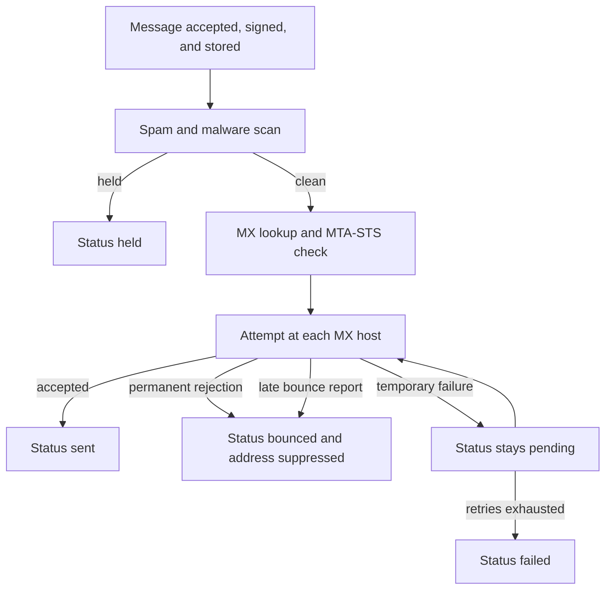

# Deliverability

Mailbox providers judge your domain by its authentication, bounce rate,
complaint rate, and content. relay handles the infrastructure part. You
handle the content and the recipient list.

This page explains what relay does for each message. It also explains what
you can do when delivery fails.

## What relay does for every message

relay manages these parts of deliverability:

- It serves the DNS values for SPF, DKIM, DMARC, MTA-STS, and TLS-RPT from
  one nameserver.
- It signs every message with the DKIM keys of your sender domain.
- It scans every message for spam and malware before delivery.
- It records and suppresses permanent bounces.
- It retries temporary failures on a fixed schedule.
- It records every attempt with the remote server reply.

See <a href="">Domains and DNS</a> for
the records. See <a href="">Sender
reputation</a> for the **Monitoring** page.

## The suppression list

relay never sends to an address on your suppression list. The list protects
your bounce rate and your domain reputation.

### Automatic entries

When a recipient server rejects a message permanently, relay adds the
recipient to the suppression list. The rejection can arrive in two ways:

- The recipient server replies with a permanent 5xx code during delivery.
- The recipient server accepts the message and sends a bounce report later.

In both cases, relay sets the message to `bounced` and suppresses the
address. Later submissions to that address get the `suppressed` status. The
SMTP transaction still replies with `250`, so your application does not retry.

relay stores each entry as a salted SHA-256 hash. relay can compare an
address with the list but cannot read the address back.

### Manage the list

Open **Suppression list** to manage entries:

- **Add** suppresses an address by hand. Use it before a large import.
- **Check** tells you whether relay will suppress the address for your organization.
- **Remove** allows delivery to the address again.
- **Clear list** removes every entry.

CAUTION: Remove single entries instead of **Clear list**. **Clear list**
removes every entry, so relay sends to all of them again. The bounces that
follow count against your sender reputation.

An address that bounced for another organization stays suppressed for 30
days. **Clear list** does not remove that shared block.

relay does not remove an entry from your list automatically. If a mailbox
accepts mail again, remove the entry yourself.

## The outbound scan

relay scans every outgoing message for spam and malware before delivery. A
message that fails the scan gets the `held` status. It never reaches the
recipient.

The scan catches a compromised credential, a broken template, or content
that can hit a spam trap before it damages your domain. The message detail
page shows the score, the scan action, and the virus verdict.

If the scan holds a message for spam, open the message. Then click **Release
and send** to deliver it. A message with malware stays held.

## Delivery retries

relay stores a message before it starts delivery. An accepted submission is
never lost when relay restarts.

### Try each host

A recipient domain can publish several MX hosts. relay tries them in
preference order. A temporary failure at one host does not stop the walk.
relay records the reply from each host.

### Retry schedule

If no host accepts the message, relay keeps the message `pending` and retries
the whole list:

| Attempt | Wait before the attempt |
| --- | --- |
| 1 | Immediate |
| 2 | 2 minutes |
| 3 | 4 minutes |
| 4 | 8 minutes |
| 5 | 16 minutes |
| 6 | 32 minutes |

The sixth failed attempt ends the message as `failed`. The whole schedule
takes about one hour.

### Permanent failures

A 5xx reply is permanent. relay sets the message to `bounced`. It also
suppresses the recipient. Do not wait for a retry.

A bounce report can also arrive after a successful delivery. relay then
changes a `sent` or `failed` message to `bounced`.

### Temporary failures

A 4xx reply, a connection error, a missing MX record, or a DNS lookup timeout
is temporary. relay records the reply. Then relay retries.

relay records a domain without MX records and a failed DNS lookup as
different failures. A delegation can take time to propagate, so relay retries
both cases.

### MTA-STS

If the recipient domain publishes an MTA-STS policy, relay skips hosts that
the policy does not list. relay records the policy that blocked the host.

If the policy blocks every host, the message ends as `failed`. relay cannot
override a published policy.

## What to do with a failed message

1. Open the **Message log**.
2. Filter by **Sent** and the `failed` status.
3. Open the message.
4. Read each transmission. The record names the host and the reply.
5. Fix the cause. A common cause is a recipient domain with no active MX
   host.

A `550` reply that names an unknown mailbox is permanent. The suppression
list already protects you. Do not retry the address.

## Maintenance window

relay runs maintenance on Wednesdays between 01:00 and 03:00 UTC. An upgrade
can drop open SMTP connections and interrupt a delivery attempt.

relay stores every message before delivery, so an interrupted attempt is
retried. Expect a delay during the window, not a lost message.

## Related pages

- <a href="">Sending</a>. Submission
  checks and SMTP replies.
- <a href="">Message
  statuses</a>. Every status and transmission record.
- <a href="">Sender reputation</a>.
  Bounce and complaint limits.
- <a href="">Domains and DNS</a>.
  Authentication records.
