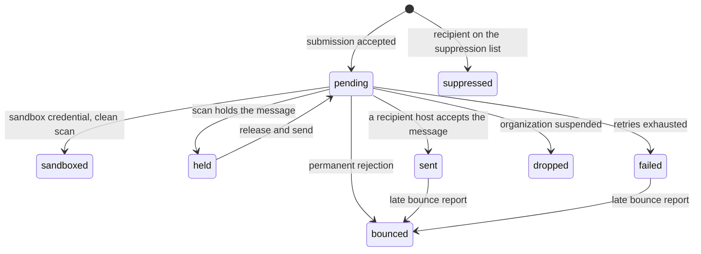
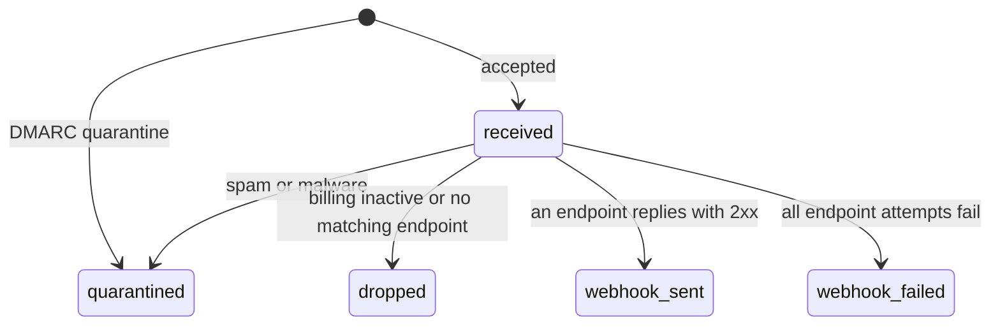

# Message statuses

Every message in the dashboard has one status. The status tells you what
relay did with the message and what it will do next. Each delivery attempt has
its own record below the message.

Use this page to read a status. Then decide what to do.

## Outgoing messages

| Status       | Meaning                                                                             | What to do                                                                                         |
| ------------ | ----------------------------------------------------------------------------------- | -------------------------------------------------------------------------------------------------- |
| `pending`    | relay stored the message. The scan or delivery is not finished.                     | Wait. Read the transmissions if the status does not change.                                        |
| `held`       | The spam or malware scan held the message. relay did not deliver it.                | Read the scan result. If it is a spam hold, click **Release and send**.                            |
| `sent`       | A recipient mail server accepted the message.                                       | Nothing. A late bounce report can still change the status to `bounced`.                            |
| `bounced`    | A recipient server rejected the message permanently.                                | The recipient is on the suppression list. Remove the entry only if the mailbox accepts mail again. |
| `failed`     | relay did not deliver the message after all retries, or MTA-STS blocked every host. | Open the transmissions and read the reply from each host.                                          |
| `suppressed` | The recipient was on the suppression list at submission.                            | relay did not deliver the message. Remove the address from the list to send again.                 |
| `sandboxed`  | The message came from a sandbox credential. relay did not deliver it.               | Nothing. The message is a test message.                                                            |
| `dropped`    | relay suspended the organization, so it dropped the queued message.                 | Contact support.                                                                                   |

### What the statuses do not tell you

`sent` means that a recipient mail server accepted the message. It does not
mean that the message reached the inbox.

A recipient server can accept a message and reject it later. It then sends a
bounce report to the per-message return path. relay changes the message to
`bounced` and suppresses the recipient.

A temporary failure does not change the status. The message stays `pending`
while relay retries. A permanent rejection changes the status to `bounced`. A
relay-side transport failure can end as `failed`.

## Incoming messages

| Status           | Meaning                                                                             | What to do                                                                     |
| ---------------- | ----------------------------------------------------------------------------------- | ------------------------------------------------------------------------------ |
| `received`       | relay accepted the message. The scan or webhook delivery is not finished.           | Wait. The message log shows the delivery attempts.                             |
| `quarantined`    | The message got a quarantine result from DMARC, the spam scan, or the malware scan. | Read the message and its score. A quarantined message never reaches a webhook. |
| `dropped`        | Billing is inactive, or no active endpoint matches the recipient.                   | Activate billing or add a matching endpoint.                                   |
| `webhook_sent`   | A matching endpoint replied with 2xx.                                               | Nothing. The delivery record shows the response.                               |
| `webhook_failed` | No matching endpoint accepted the message.                                          | Read the delivery record. Read the response code and the endpoint state.       |

A message that hits a `p=reject` DMARC policy never gets a status. relay
rejects it during the SMTP transaction, so the message is never stored.

## Delivery attempts

A transmission is one step of one message. An outgoing message starts with a
submission record. Each delivery attempt adds a record. An incoming message
starts with a reception record. Each webhook `POST` adds a delivery record.

| Transmission status | Meaning                                                                   |
| ------------------- | ------------------------------------------------------------------------- |
| `received`          | relay accepted the message on inbound SMTP.                               |
| `submitted`         | relay accepted the message for delivery.                                  |
| `sandboxed`         | A sandbox credential submitted the message. No delivery attempt followed. |
| `sent`              | This attempt reached a recipient host that accepted the message.          |
| `bounced`           | This attempt got a permanent rejection, now or in a later bounce report.  |
| `failed`            | This attempt failed. The record names the host and the reason.            |
| `retry`             | A bounce report announced a delay. The remote server keeps trying.        |

One delivery walk adds one record for each host that relay reached. A failed
walk keeps the reply from every host, including hosts that MTA-STS rejected.

An attempt that opens a connection records the sending IP and the recipient
host IP. A reception records both ends of the inbound connection. Every retry
adds its own records, so the timeline shows every attempt and the wait before
it.

## Read the message detail page

Open a message from the **Message log**. The detail page shows:

- The status badge and the scan result.
- The sender, recipient, and subject.
- The transmissions with their status and time.
- The message body and the headers.

Click a bar in the timeline to open its SMTP transcript. The transcript
shows the conversation with the remote server, the TLS details, and the
reply code.

The timeline colors each attempt:

| Color  | Meaning                                           |
| ------ | ------------------------------------------------- |
| Green  | The attempt succeeded.                            |
| Red    | The attempt failed.                               |
| Yellow | The remote server asked relay to retry.           |
| Blue   | The inbound reception or the outbound submission. |

The scan bar uses green for a clean result, yellow for a hold or rewrite, and
red for a rejection. A gray scan bar means the check failed.

## Antivirus badge

relay scans every message for malware. The detail page shows the result:

| Badge            | Meaning                                                    |
| ---------------- | ---------------------------------------------------------- |
| `no virus`       | The scan found nothing.                                    |
| `virus: name`    | The scan found a virus. The badge names it.                |
| `encrypted part` | The scan did not read a password-protected attachment.     |
| `macro`          | The scan did not inspect an attachment with Office macros. |
| `scan limits`    | The attachment was larger than the scan limit.             |

Until a scan completes, the message shows no antivirus badge. relay retries
the scan.

An encrypted part, a macro, or a size limit hides content from the scanner.
relay treats these results as a detection and holds or quarantines the
message.

## Find messages

The **Message log** has these filters:

- **All**, **Sent**, or **Received**.
- A status.
- An email address in the search field.

The 30-day chart counts the messages that the current filter selects. The
unfiltered chart shows outgoing messages above the axis and incoming messages
below it.

A sandbox message carries a blue **sandbox** badge beside its status while it
is pending or held. The `sandboxed` status uses the same blue.

## Related pages

- <a href="">Sending</a>. The submission
  checks and SMTP replies.
- <a href="">Receiving</a>. The
  inbound checks and webhook retries.
- <a href="">Deliverability</a>.
  Retries, bounces, and the suppression list.
