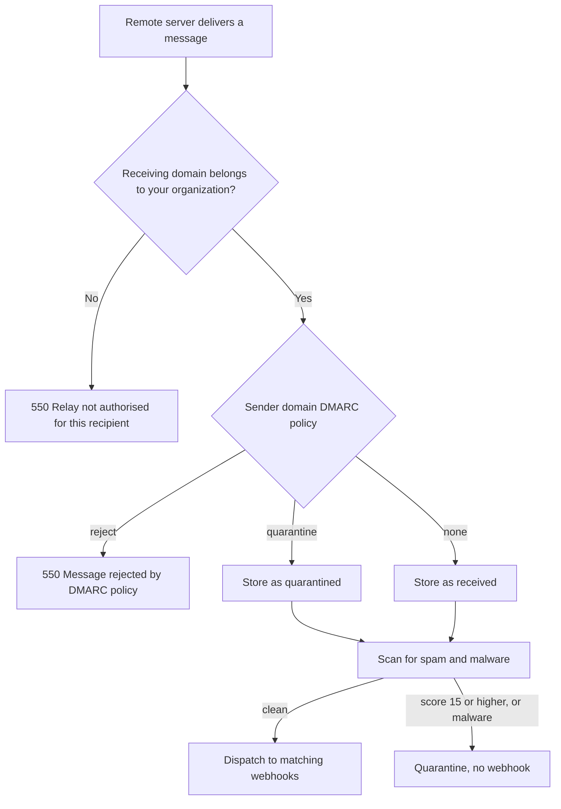

# Receiving

An MX record points at the relay MX server. A remote mail server
delivers a message to relay. relay examines the recipient, filters spam, and
sends the result to your HTTPS endpoint.

This page explains how to configure inbound mail and how to verify webhook
deliveries.

## Before you start

You need a domain in your organization. The managed sender domain is active
without DNS setup. To receive mail on your own address, use your own domain
or a subdomain, for example `app.acme.com`.

You also need an HTTPS endpoint in your application. relay sends a `POST`
request to this endpoint for each accepted message.

## Configure inbound mail

### 1. Point the MX record at relay

Open **Domains**. Select your domain. Then click the **Receiving** tab.
Publish the MX records that the page shows.

| Type | Name                  | Priority | Value           |
| ---- | --------------------- | -------- | --------------- |
| `MX` | Your receiving domain | `10`     | `mx1.relays.to` |
| `MX` | Your receiving domain | `10`     | `mx2.relays.to` |

The page shows the exact names for your domain. If your DNS provider imports
zone files, use the **Zone file** button.

### 2. Verify the domain

Click **Verify DNS**. relay reads the live DNS records and shows a check for
each record.

If the MX record is missing, relay cannot accept mail for the domain. A
sending-only domain can leave the MX record out.

### 3. Create an endpoint

Open **Inbound email**. Then click **New endpoint**. Enter these values:

| Field           | Value                                                               |
| --------------- | ------------------------------------------------------------------- |
| URL             | An HTTPS URL in your application.                                   |
| Name            | The endpoint name.                                                  |
| Domain          | The receiving domain.                                               |
| Address pattern | The recipients this endpoint accepts, for example `*@app.acme.com`. |

The pattern is a glob over the full recipient address. Examples:

- `*@app.acme.com` receives every address at the domain.
- `support@acme.com` receives one address.
- `bill+*@acme.com` receives every plus-extension of one address.

relay creates a signing secret for each endpoint. Copy the secret from the
**Inbound email** page. You need it to verify deliveries.

## What relay accepts

relay runs these checks before it stores an inbound message:



### Recipient check

relay accepts only recipients on a domain that belongs to your organization,
including managed domains and subdomains. Any other recipient gets
`550 Relay not authorised for this recipient`.

### DMARC

relay reads the DMARC policy of the sender domain. If the policy is
`p=reject` and the message fails, relay rejects the message during the SMTP
transaction. The message never enters relay.

If the policy is `p=quarantine`, relay stores the message as `quarantined`.
Quarantined messages do not reach your webhook. You can read them in the
message log.

### Spam and malware

relay scans each accepted message. A message gets the `quarantined` status in
three cases: the score is 15 or higher, the scan action is reject, or the scan
finds malware. The message detail page shows the score and the virus name.

Scanning happens after relay replies with `250`. A slow scan delays the webhook,
not acceptance.

### Authentication results and ARC

relay records the SPF, DKIM, and DMARC results of the inbound hop. relay seals
the results with ARC, so a later receiver can verify that the results came
from relay. The raw message contains the seal and a `Received` header with
the sending host, the relay MX host, the protocol, and the time.

See the know-how article on
<a href="">ARC</a> for the protocol
background.

## Webhook payload

relay sends a flat JSON body. The raw message is not in the body. A signed
`body_url` points to the raw message.

```json
{
  "type": "email.received",
  "message_id": "0198b7c2-7c11-7000-8000-3b9bb91234af",
  "sender": "ann@example.net",
  "recipient": "kim@app.acme.com",
  "subject": "Quote request",
  "rfc822_message_id": "<ab12@example.net>",
  "received_with_tls": true,
  "receiving_domain": "app.acme.com",
  "body_url": "https://storage.relays.to/messages/0199....eml?signature=...",
  "spam_score": 1.5,
  "spam_action": "no action",
  "received_at": "2026-08-29T09:41:18Z"
}
```

| Field               | Meaning                                                                                    |
| ------------------- | ------------------------------------------------------------------------------------------ |
| `type`              | `email.received` for real mail, `email.test` for a test delivery.                          |
| `message_id`        | The relay message ID. Use it to open the message in the dashboard.                         |
| `sender`            | The envelope sender.                                                                       |
| `recipient`         | The envelope recipient.                                                                    |
| `subject`           | The subject header.                                                                        |
| `rfc822_message_id` | The `Message-ID` header of the message.                                                    |
| `received_with_tls` | Whether the inbound connection used TLS.                                                   |
| `receiving_domain`  | The domain that accepted the message.                                                      |
| `body_url`          | A signed download URL for the raw message. The URL expires, so download the body promptly. |
| `spam_score`        | The spam score.                                                                            |
| `spam_action`       | The scan action, for example `no action`.                                                  |
| `received_at`       | The delivery timestamp, in UTC.                                                            |

A test delivery has type `email.test`. Most fields are empty and `body_url`
is `null`. Use the **Test** button on an endpoint to send one.

## Delivery headers and signatures

relay signs each delivery. The request carries these headers:

| Header              | Value                                   |
| ------------------- | --------------------------------------- |
| `webhook-id`        | `msg_<uuid>`, unique for each delivery. |
| `webhook-timestamp` | Unix seconds at signing time.           |
| `webhook-signature` | `v1,<base64 HMAC-SHA256 signature>`.    |
| `Content-Type`      | `application/json`.                     |

The signed content is `{id}.{timestamp}.{body}`. The signature is an
HMAC-SHA256 signature of that byte string with the endpoint signing secret.

Deliveries follow the [Standard Webhooks](https://standardwebhooks.com)
specification. Use a Standard Webhooks SDK to verify them.

## Verify a delivery

Before you process the payload, verify the signature. If the signature is not
valid, do not process the payload.

```python
import json

from standardwebhooks import Webhook

wh = Webhook("whsec_your_signing_secret")


def handler(payload: bytes, headers: dict[str, str]) -> None:
    event = wh.verify(payload, headers)
    body = json.loads(payload)
    if body["type"] == "email.received":
        download(body["body_url"])
```

SDKs exist for other languages, including Node.js, Go, Ruby, and Rust. The
SDK verifies the timestamp, so an old delivery fails verification.

## Retry schedule

relay expects a 2xx reply within 30 seconds. Any other reply, a timeout, or
a connection error is a failure.

| Attempt | Delay before the attempt |
| ------- | ------------------------ |
| 1       | Immediate                |
| 2       | 5 seconds                |
| 3       | 5 minutes                |
| 4       | 30 minutes               |
| 5       | 2 hours                  |
| 6       | 5 hours                  |
| 7       | 10 hours                 |
| 8       | 14 hours                 |
| 9       | 20 hours                 |
| 10      | 24 hours                 |

relay adds 0 to 29 seconds of random delay to each attempt. Ten attempts
cover about three days.

A successful delivery sets the message to `webhook_sent`. If every attempt
fails, the message gets the `webhook_failed` status.

The endpoint replies with `410 Gone` to tell relay that it no longer exists. relay
deactivates the endpoint and stops future deliveries to it. If no other
endpoint accepts the message, it gets the `webhook_failed` status.

Deliveries can arrive more than once. Deduplicate on `webhook-id`.

## Delivery records

Open an inbound message in the message log to see each delivery attempt. The
page shows the endpoint URL, the response code, and up to 2,000 characters of
the response body.

Use the record to find a slow endpoint, a wrong signature, or a server error.

## Report addresses

relay accepts report traffic for your domains automatically. These messages
are not delivered to your webhooks.

| Address                             | Purpose                                              | What relay does                                                            |
| ----------------------------------- | ---------------------------------------------------- | -------------------------------------------------------------------------- |
| `dmarc@{sender-subdomain}`          | DMARC aggregate reports                              | relay stores and parses the XML report.                                    |
| `ruf@{sender-subdomain}`            | DMARC failure reports                                | relay stores and parses the report.                                        |
| `tls@{sender-subdomain}`            | TLS reports                                          | relay stores and parses the JSON report.                                   |
| `bounce+{token}@{sender-subdomain}` | Bounce reports for one outgoing message              | relay marks that message as a hard bounce.                                 |
| `postmaster@{your-domain}`          | Mail to postmaster, with or without a plus extension | relay stores the message and forwards a copy to your organization members. |

The DMARC and TLS addresses are collectors. Your DMARC and TLS-RPT records
point at them. relay handles the reports and shows them in the dashboard.

The bounce address is unique for each outgoing message. relay accepts a
bounce report only for an address that relay created and only when the report
names the original recipient. A permanent failure marks the original message
as a hard bounce and suppresses the recipient.

### Postmaster copies

relay forwards mail to `postmaster@` to every organization member with an
email address. Each copy is a real message from the postmaster address of the
receiving domain. Replies reach the original sender.

The copy is an outgoing message. It counts toward your monthly volume. A
quarantined message is never forwarded.

## Reading inbound mail

The **Message log** lists inbound and outbound messages. Use the **Received**
filter to show inbound mail only.

The list shows the sender, recipient, status, and time. Open a message to
read the headers, the body, the TLS details, the spam score, and the
transmissions.

Quarantined messages stay readable, with their score and virus verdict.

## Troubleshooting

| Symptom                                                       | Likely cause                                           | Fix                                                                    |
| ------------------------------------------------------------- | ------------------------------------------------------ | ---------------------------------------------------------------------- |
| The sender gets `550 Relay not authorised for this recipient` | The recipient domain is not added or not verified.     | Add the domain. Then verify its MX record.                             |
| No webhook fires                                              | No endpoint matches the recipient.                     | Make sure that the address pattern and the domain are correct.         |
| No webhook fires                                              | The message is quarantined.                            | Read the message in the log. Then read the spam score.                 |
| No webhook fires                                              | Billing is inactive.                                   | Activate billing. relay drops inbound messages without active billing. |
| Signature verification fails                                  | The signing secret is wrong or the raw body changed.   | Copy the secret again. Then verify the exact request body.             |
| Deliveries repeat                                             | The endpoint replied with a non-2xx code or timed out. | Reply with 2xx. Then process the message after the response.           |

## Related pages

- <a href="">Domains and DNS</a>. Add a
  domain. Then verify its MX record.
- <a href="">Message
  statuses</a>. Inbound statuses and delivery records.
- <a href="">Sender reputation</a>.
  DMARC and TLS reports.
