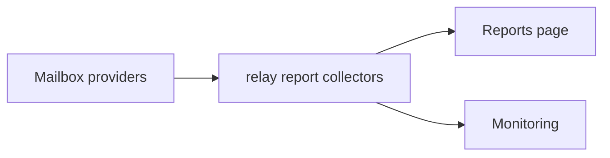

# Sender reputation

Mailbox providers grade your sender domain. They look at authentication,
bounce rates, complaint rates, spam rates, and infrastructure. A poor grade
sends your mail to the spam folder or drops it.

relay manages the infrastructure part and shows you the rates that matter.
This page explains how to read them. It also explains how to keep them low.

## Your domain carries your reputation

relay signs each message with the DKIM keys of your sender domain. The
envelope sender uses your sender subdomain. As a result, a receiver attributes
the message to your domain, not to relay or to another organization.

A domain keeps its reputation when it moves to relay. Make sure that the
domain is in good standing before you migrate.

## Monitor your rates

Open **Monitoring** to see these values:

| Card             | What it shows                                                               | Limit                 |
| ---------------- | --------------------------------------------------------------------------- | --------------------- |
| Hard bounce rate | Permanent rejections divided by sent messages.                              | 5%                    |
| Soft bounce rate | Messages whose retries ran out after a 4xx reply, divided by sent messages. | Display only          |
| Complaint rate   | Complaints and held messages divided by sent messages.                      | 0.1%                  |
| Cost             | Your message volume and monthly cost.                                       | Depends on your plan. |

The rates use a rolling 7-day window. Only the hard bounce rate and the
complaint rate can suspend an organization. The soft bounce rate is display
only. It does not count toward a suspension. A temporary 4xx refusal alone
never suspends an organization.

Members can receive a weekly digest with the hard bounce rate and the
complaint rate. Change the notification in **Notifications**.

## Suspension

relay suspends an organization when the hard bounce rate or the complaint
rate is more than its limit and the organization sent at least 100 messages
in the window.

A suspended organization has these limits:

- New submissions fail with `550 Account suspended due to sender reputation`.
- Queued messages get the `dropped` status.
- relay notifies the organization admins by email.

relay never removes a suspension automatically. Contact support to resolve
it.

## Keep the rates low

### Protect your bounce rate

- Keep the suppression list. relay adds permanent bounces automatically.
- Do not clear the whole suppression list. Remove one address at a time.
- Send only to addresses that gave you permission.
- Add known bad addresses to the suppression list before a large send.

See <a href="">Deliverability</a>
for the suppression list.

### Protect your complaint rate

- Send mail that the recipient expects.
- Make the unsubscribe path easy.
- Remove recipients who complain.
- Watch the outbound spam scan. A held message counts toward the complaint
  rate.

### Keep your records complete

A domain with partial records gets a poor grade. Publish the SPF, DKIM, DMARC,
MTA-STS, and TLS-RPT records for every sender domain. See
<a href="">Domains and DNS</a>.

## Read provider reports

Open **Reports** to see the reports that providers send to relay. Use the
filters to select a report type, a domain, or a source IP.

| Report              | What it contains                                                  | What to do                                                            |
| ------------------- | ----------------------------------------------------------------- | --------------------------------------------------------------------- |
| DMARC               | Aggregate XML with the authentication results for your domain.    | Examine the sources that fail. Fix or block a sender you do not know. |
| DMARC failures      | A sample of a message that failed DMARC.                          | Read the headers. Then find the source.                               |
| TLS                 | Success and failure counts for TLS connections to your MX hosts.  | If failures increase, examine your MTA-STS and TLS-RPT records.       |
| FBL (feedback loop) | A complaint report for a message that a recipient marked as spam. | Remove the recipient. Then review the message content.                |

The DMARC and TLS reports arrive because your DNS records name relay as the
collector. See <a href="">Receiving</a>
for the report addresses.

### Complaint matching

relay matches each complaint to the message that caused it. A message counts
once, however many reports name it.

A report that relay cannot match stays in the message log as inbound mail. It
does not count as a complaint.

### Feedback-ID

relay adds a `Feedback-ID` header to each outgoing message. The header groups
your mail by sender domain, organization, and mail type. Gmail uses the
header to group complaint rates.

Verify your domain in Google Postmaster Tools to see the rates there. The
header format is on the
<a href="">Feedback-ID</a>
page.

## A weekly routine

1. Open **Monitoring**. Then compare both rates with their limits.
2. Open **Reports**. Then read the new DMARC and TLS reports.
3. Fix failing sources, expired records, or a sudden bounce source.
4. Review the suppression list for entries that you can remove after a
   mailbox is fixed.
5. Examine the message log for held or failed messages.

## Related pages

- <a href="">Deliverability</a>.
  Suppression, retries, and the outbound scan.
- <a href="">Receiving</a>. Report
  addresses and inbound filtering.
- <a href="">Domains and DNS</a>. The
  records that providers grade.
