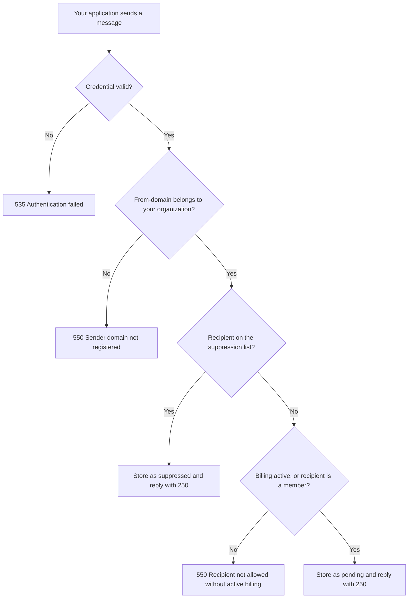

# Sending

Use relay to send transactional email from your application. Your application
connects to the relay submission host over SMTP. relay accepts the message,
examines it, and delivers it to the recipient.

## Before you start

You need three things:

- An organization. Register with GitHub. relay creates your personal
  organization.
- An SMTP credential. Open **Credentials**. Then create a credential. The key
  appears once. Before you close the dialog, copy it.
- A sender domain. Every organization gets a managed sender domain, for
  example `acme.open.relays.to`. It is active immediately and needs no DNS
  setup.
  To send from your own domain, add the domain first. Then verify it. See
  <a href="">Domains and DNS</a>.

The SMTP username is your organization slug. The SMTP password is the
credential key.

## Connect over SMTP

| Setting | Value |
| --- | --- |
| Host | `smtp.relays.to` |
| Port with STARTTLS | `587` |
| Port with implicit TLS | `465` |
| Username | Your organization slug |
| Password | Your credential key |
| Authentication | `AUTH PLAIN` |

relay rejects plaintext submission. Port 587 needs STARTTLS before AUTH. Port
465 uses TLS from the first byte.

If your network allows port 465, use it. If a firewall blocks port 465, use
port 587.

After you create a credential, the dialog shows the same values as an
`smtps://` URI with the key in it. Before you close the dialog, copy the URI.

## Send a test message

Python with the standard library:

```python
import smtplib
import ssl

with smtplib.SMTP("smtp.relays.to", 587) as server:
    server.starttls(context=ssl.create_default_context())
    server.login("acme", "your-credential-key")
    server.sendmail(
        "billing@acme.com",
        ["kim@example.net"],
        "From: billing@acme.com\r\n"
        "To: kim@example.net\r\n"
        "Subject: Invoice\r\n"
        "\r\nYour invoice is ready.\r\n",
    )
```

Libraries that speak SMTP use the same five values: host, port, TLS mode,
username, and password.

You can also send a test message from the dashboard. Open **Message log**.
Then click **Send test email**. relay sends the message to your account
address.

## Submission checks

relay runs these checks on each message inside the SMTP transaction:



### Sender domain

The From-address must use a domain that you added to your organization. To
send from a subdomain, add the subdomain as a domain first. relay makes sure
that the domain belongs to your organization and that it is the closest
registered domain for the address.

### Suppression list

If the recipient is on your suppression list, relay accepts the message but
does not deliver it. The message gets the `suppressed` status. The SMTP
transaction still replies with `250`, so your application does not retry.

See <a href="">Deliverability</a>
for the suppression list.

### Billing

When billing is inactive, relay accepts messages only to members of your
organization. Use a member address for a test. Activate billing to send to
external recipients.

### Suspended organizations

If relay suspends your organization for sender reputation, submissions fail
with `550 Account suspended due to sender reputation`.

## SMTP replies

| Reply | Meaning | What to do |
| --- | --- | --- |
| `235 Authentication successful` | The credential is valid. | Send the message. |
| `250 OK` | relay accepted the message. | Examine the message log for the delivery status. |
| `530 Authentication required` | The connection is not over TLS, or AUTH did not run. | Use STARTTLS or port 465 before AUTH. |
| `535 Authentication failed` | The organization slug or key is wrong, or the support team placed the credential on hold. | Make sure that the slug and key are correct. Contact support if the credential is on hold. |
| `550 Sender domain not registered` | The From-domain does not belong to your organization. | Use a verified sender domain. |
| `550 Recipient not allowed without active billing` | Billing is inactive and the recipient is not a member. | Activate billing or use a member address. |
| `550 Account suspended due to sender reputation` | relay suspended the organization. | Contact support. |

## After acceptance

relay signs the message when it accepts the submission. relay stores the
signed message before it starts delivery. A `250` reply means that relay has
the message, not that it delivered it.

relay then does these steps:

1. Scans the message for spam and malware.
2. Looks up the recipient MX hosts.
3. Attempts delivery to each host.
4. Records every attempt in the message log.

If the scan holds the message, relay does not deliver it. The message gets
the `held` status. Open the message detail page. Then click **Release and
send** to deliver a held message. Release is available only for spam holds. A
message with malware stays held.

A temporary delivery failure keeps the message `pending`. relay retries after
2, 4, 8, 16, and 32 minutes. After the sixth failed attempt, the message gets
the `failed` status.

See <a href="">Message
statuses</a> for every status.

## Sandbox credentials

Create a sandbox credential for your integration tests. relay stores and
scans a message from a sandbox credential. relay never transmits it. The
message gets the `sandboxed` status.

A sandbox credential is for development. A normal credential is for
production.

## Troubleshooting

| Symptom | Likely cause | Fix |
| --- | --- | --- |
| `535 Authentication failed` | Wrong organization slug or key. | Copy the slug from the dashboard. Create a new key if you lost the old one. |
| `530 Authentication required` | The application sent AUTH before STARTTLS. | Use STARTTLS or port 465. |
| `550 Sender domain not registered` | The From-domain is not verified for this organization. | Add the domain or use the managed domain. |
| The message stays `pending` | Delivery retries are in progress. | Open the message detail page and read the transmissions. |
| The message is `held` | The spam or malware scan held it. | Read the scan result. Release spam holds only. |

## Related pages

- <a href="">Domains and DNS</a>. Add
  and verify your own sender domain.
- <a href="">Deliverability</a>.
  Suppression, retries, and delivery failures.
- <a href="">Message
  statuses</a>. Every status and attempt record.
